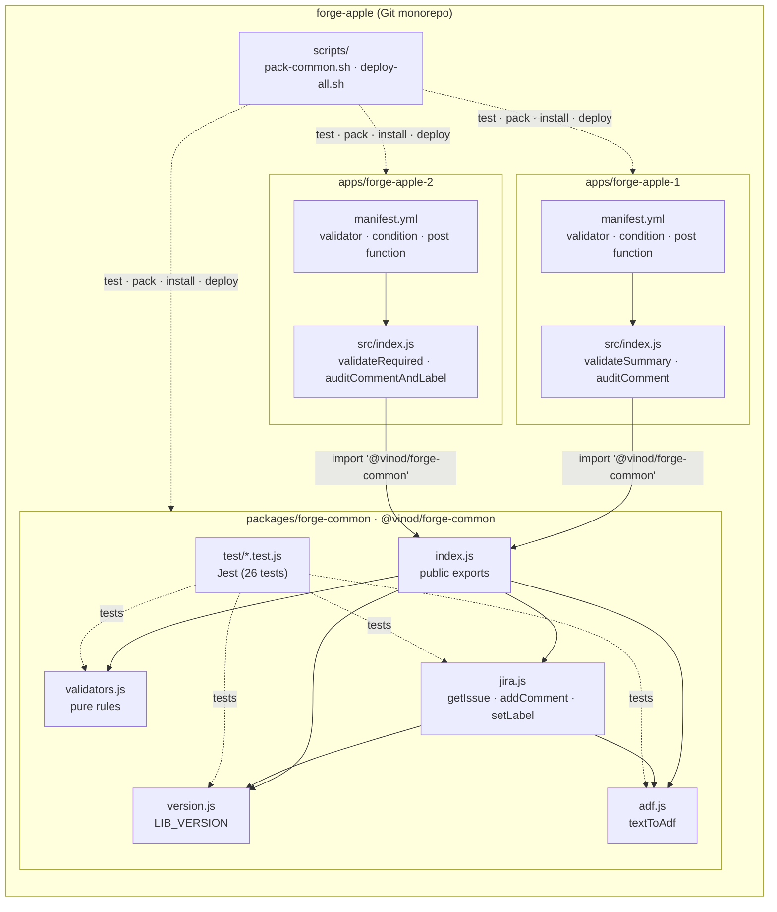
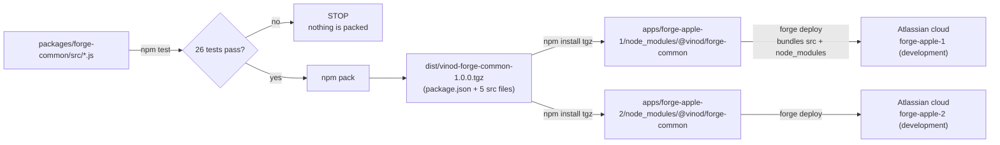
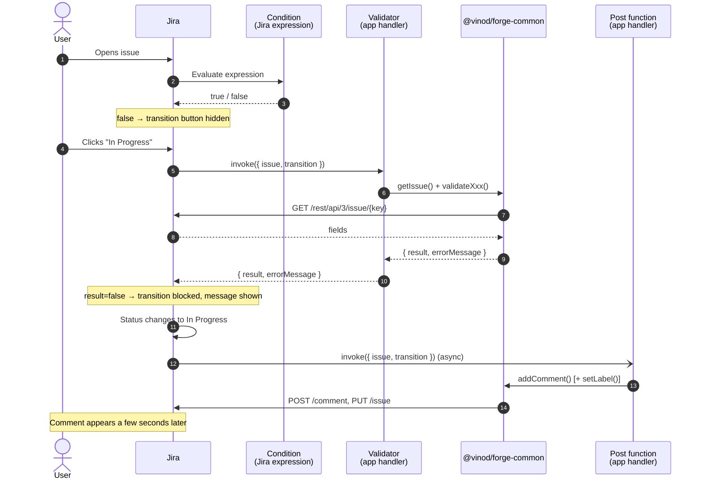
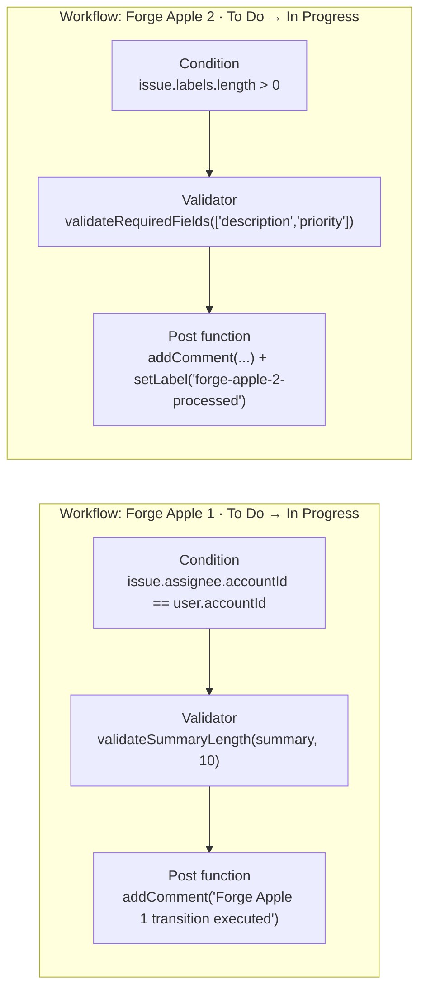
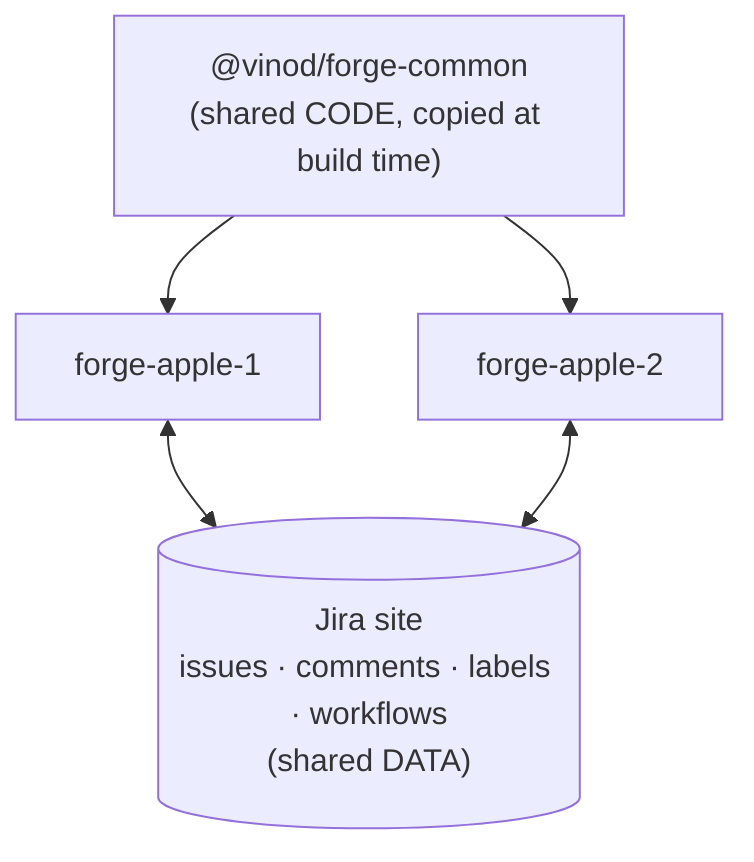

# Architecture

This document explains how the forge-apple monorepo fits together:
- which pieces exist
- how the shared library reaches both apps
- what happens inside Jira when a workflow transition runs

For a file-by-file explanation of the code, see [CODE-WALKTHROUGH.md](CODE-WALKTHROUGH.md).

---

## 1. Goal

Two Jira Forge apps need overlapping logic: reading issues, validating fields and writing audit comments.
Instead of copying that logic into each app, it lives in **one library**, `@vinod/forge-common`. The library is:

- **written once**, in `packages/forge-common/src`
- **unit-tested once**, in `packages/forge-common/test` (26 Jest tests, no Jira needed)
- **reused by both apps**, which contain only thin handlers that call the library

---

## 2. Component overview

| Component | Responsibility | Knows about Jira? | Knows about Forge? |
|---|---|---|---|
| `validators.js` | Decide whether data is valid | Only the `{result, errorMessage}` shape | No |
| `adf.js` | Build comment bodies in Atlassian Document Format | ADF format only | No |
| `jira.js` | Call the Jira REST API | Yes | Yes (`@forge/api`) |
| App `src/index.js` | Translate Jira workflow events into library calls | Event payloads | Yes (handler signatures) |
| App `manifest.yml` | Tell Jira which rules exist and which handler runs each one | Yes | Yes |

Keeping `validators.js` and `adf.js` free of Forge calls makes them trivial to test and reuse anywhere.

---

## 3. How the library gets into each app

Forge bundles only files that are **inside the app folder**. A folder link created by
`npm install ../../packages/forge-common` is a symlink pointing *outside* the app, so it breaks `forge tunnel`.
Instead, the library is shipped as an npm **tarball** and each app installs a real copy of it.

Key points:

- **`"files": ["src"]`** in the library's `package.json` keeps tests out of the tarball.
- **The version is in the file name**, e.g. `vinod-forge-common-1.1.0.tgz`, so bumping the version produces a new artifact.
- **`@forge/api` is a peer dependency.** The library does not ship its own copy; each app provides it,
  so there is exactly one `@forge/api` per bundle.
- **`scripts/deploy-all.sh` automates the whole diagram**, for both apps, in one command.

---

## 4. Runtime: what happens during a transition

A Jira workflow transition can run three kinds of Forge rules. They run at different times:

| Rule type | Runs | Implemented as | Can block? | Return value |
|---|---|---|---|---|
| **Condition** | When the issue is viewed | Jira expression in `manifest.yml` (no code) | Hides the transition | Boolean |
| **Validator** | When the user attempts the transition | App function | Yes, with a message | `{ result, errorMessage? }` |
| **Post function** | After the transition, asynchronously | App function | No | Ignored; errors go to `forge logs` |

### The rules in each app

---

## 5. How the two apps relate

The apps **do not call each other**. Forge has no app-to-app calls, and each app has its own ID,
scopes, storage and deployment. They share:

| Shared? | What |
|---|---|
| ✅ Code | `@vinod/forge-common`; each app holds an identical copy |
| ✅ Jira data | Both apps read and write the same issues, comments and labels |
| ✅ Workflows | One workflow can contain rules from both apps (README §5.2) |
| ❌ Forge Storage | Private to each app |
| ❌ Function calls | No direct app-to-app calls |

If the apps ever need to exchange data, the recommended route is through Jira, e.g. **issue properties**.
Add `getIssueProperty` and `setIssueProperty` to `jira.js` once, and both apps can use them.

---

## 6. Design decisions

| Decision | Why |
|---|---|
| Tarball instead of folder link or workspaces | Forge only bundles files inside the app folder; tunnel and deploy break with symlinks |
| `@forge/api` as a peer dependency | Avoids two copies in one bundle; the app controls the version |
| `api.asApp()` instead of `asUser()` | Validators and post functions are invoked by Jira with no interactive user session |
| `route` tagged template | Forge requires it; it URL-encodes values and prevents path injection |
| Validators **fail closed** | If Jira cannot be read, block the transition instead of letting bad data through |
| Validators read `transition.modifiedFields` first | Values typed on a transition screen are not saved yet; this checks what the user entered |
| `setLabel` uses `update.labels.add` | `fields.labels` would replace all labels; `add` keeps existing ones |
| Conditions are Jira expressions | Evaluated by Jira itself: instant, no function invocation cost |
| `LIB_VERSION` in every comment, enforced to match `package.json` | Visible proof of which library build each app is running |
| Minimal scopes `read:jira-work`, `write:jira-work` | Least privilege: just enough to read issues and write comments and labels |

---

## 7. Environments and site

| Item | Value |
|---|---|
| Jira site | `vinodsirii.atlassian.net` |
| Forge account | `vinodsirii.228@gmail.com` (app owner and site admin) |
| Environment | `development` |
| forge-apple-1 app ID | `fbb12828-bdc6-4e33-86f8-66e98d5b305a` |
| forge-apple-2 app ID | `9da1f2d9-37e1-4a3a-a000-c0ed5ff96d6f` |
| Runtime | `nodejs22.x`, arm64, 256 MB |
