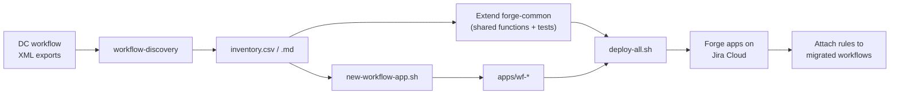

# Workflow migration plan: Jira Data Center → Jira Cloud (Forge)

This plan moves custom workflow logic (ScriptRunner, JSU, JMWE, in-house plugins) from Jira Data Center
to Forge apps in Jira Cloud. It reuses the pattern proven in this repo:

- **One shared library** (`@vinod/forge-common`) holds all rule logic. It is written once and unit-tested once.
- **One thin Forge app per workflow** (or per team) only wires that workflow's transitions to the library.
- **Tooling** generates the inventory, scaffolds the apps and deploys them all with one command.

| Tool | Path | Purpose |
|---|---|---|
| Workflow discovery | `tools/workflow-discovery` | Reads DC workflow XML exports and builds the migration inventory (CSV + Markdown) |
| App template | `templates/workflow-app` | Starting point for each workflow app |
| Scaffold script | `scripts/new-workflow-app.sh` | Creates and registers a new workflow app from the template |
| Deploy script | `scripts/deploy-all.sh` | Tests and packs the library, then deploys **every** registered app in `apps/` |



---

## Phase 1: Discovery and mapping

### 1.1 Export the workflows from Data Center

For each workflow, go to **Jira administration → Issues → Workflows → View → Export → As XML**.
Save the files into one folder and **name each file after the workflow** (the XML does not contain the name):

```
workflow-exports/
├── Purchase Approval.xml
├── Incident Handling.xml
└── ...
```

`workflow-exports/` is in `.gitignore`, because exports can contain scripts and internal details.

### 1.2 Generate the inventory

```bash
cd ~/Forge-WorkFlow-Apps/forge-apple/tools/workflow-discovery
npm install
node src/cli.js ../../workflow-exports --out ../../migration-inventory          # custom rules only
node src/cli.js ../../workflow-exports --out ../../migration-inventory --all    # also built-in rules
```

This produces:

- **`inventory.csv`**: one row per rule. Open it in Excel or Google Sheets and use the **Status** column to track progress.
- **`inventory.md`**: a summary per workflow (transitions, custom rule count, vendors) plus the full rule table.

For every transition (initial, global, common and per-status), the tool records:

| Column | Meaning |
|---|---|
| Workflow, Transition, From, To, Scope | Where the rule lives |
| Rule type | condition / validator / post-function |
| Vendor | ScriptRunner, JSU, JMWE, Workflow Toolbox, Jira (built-in) or Unknown / in-house |
| DC rule | Short class name, e.g. `GroovyValidator` |
| Details / script | The Groovy script or settings (first 120 characters) |
| Forge target | The Forge module that replaces it |
| Status | `to do`, `native` (built-in, migrates by itself) or `no custom rules` |

Built-in Jira rules (e.g. "Only assignee", "Permission validator", "Update issue status") exist natively in
Cloud and migrate with JCMA. Only rows with Status **to do** need building.

### 1.3 Map each DC feature to Forge

| DC feature | Forge Cloud replacement | Notes |
|---|---|---|
| Workflow condition | `jira:workflowCondition` | **Jira expression** in the manifest, no code. Groovy logic must be rewritten as an expression |
| Workflow validator | `jira:workflowValidator` | Jira expression or function; the function returns `{ result, errorMessage }` |
| Post function | `jira:workflowPostFunction` | Function; runs **asynchronously** after the transition |
| Listener (issue created/updated…) | `trigger` on `avi:jira:*` events | Not tied to a transition |
| Behaviours | `jira:uiModifications` | See the Behaviors app |
| Scheduled job / service | `scheduledTrigger` | |
| Script REST endpoint | `webtrigger` | Needs its own authentication |

**Not 1:1.** Groovy has full server access, while Forge uses the REST API with scopes. Some scripts will need
redesigning, for example ones that run as another user, read the database directly or call internal Java APIs.
Flag these in the inventory as `redesign`.

### 1.4 Decide the app layout

| Choose | When |
|---|---|
| **One app per workflow** (default) | Different owners, different scopes, independent releases |
| **One app for a group of workflows** | Same team, same scopes, released together: fewer installs and deploys |

Record the target app for each workflow in the inventory.

### 1.5 Prioritise

Suggested order: business-critical and most-used workflows first, then the rest. Rules marked
`redesign` should be started early, because they take the longest.

---

## Phase 2: Extend the shared library

Go through the `to do` rows and group them by **what they do**, not by workflow. Typical groups are
"required fields", "set field", "add comment" and "assignee checks". Each group becomes one library function.

```
packages/forge-common/src/
├── validators.js   pure rules: required fields, lengths, regex, dates…
├── jira.js         getIssue, addComment, setLabel, + new: setField, assignIssue…
└── adf.js          comment formatting
```

For every new function:

1. Write it in `src/`, then export it from `src/index.js`.
2. Add unit tests in `test/` and run `npm test`. No Jira is needed.
3. Bump the version: a **minor** version for a new function, a **major** version for a breaking change.
   Update both `package.json` and `src/version.js`; `version.test.js` enforces that they match.

Once several teams or repos use the library, publish it to **Artifactory** and switch each app from the
tarball to a version (see the architecture notes).

---

## Phase 3: Create a workflow app

```bash
cd ~/Forge-WorkFlow-Apps/forge-apple
./scripts/new-workflow-app.sh wf-purchase-approval PA "Purchase Approval"
```

| Argument | Example | Used for |
|---|---|---|
| App name | `wf-purchase-approval` | Folder `apps/<name>` and the Forge app name |
| Rule prefix | `PA` | Rule names (`PA – Validator: …`) and module keys (`pa-…`) |
| Workflow name | `"Purchase Approval"` | Comments, README, audit text |

The script:

1. Copies `templates/workflow-app` to `apps/<name>` and fills in the placeholders.
2. Runs the library tests, packs the library and installs it together with `@forge/api`.
3. Runs `forge register`, which gives the app its **own app ID**. This step is interactive: pick the
   Developer Space and accept the terms. Then it runs `forge lint`.

Pass `--no-register` to skip step 3, for example to review the files first.

Then replace the three **EXAMPLE** rules with the workflow's rules from the inventory:

**Condition** (Groovy `isUserMemberOfRole('Developers')` → Jira expression):

```yaml
jira:workflowCondition:
  - key: pa-developers-only-condition
    name: "PA – Condition: Developers only"
    description: "Only members of the Developers role can transition."
    expression: user.getProjectRoles(project).map(r => r.name).includes('Developers')
```

**Validator** (Groovy `issue.summary.length() >= 10` → library function):

```yaml
jira:workflowValidator:
  - key: pa-summary-length-validator
    name: "PA – Validator: Summary length ≥ 10"
    description: "Blocks the transition unless the summary has at least 10 characters."
    function: pa-validate-summary
function:
  - key: pa-validate-summary
    handler: index.validateSummary
```

```js
import { getIssue, validateSummaryLength } from '@vinod/forge-common';

export const validateSummary = async (args) => {
  const summary = args.transition?.modifiedFields?.summary
    ?? (await getIssue(args.issue.key, ['summary'])).fields.summary;
  return validateSummaryLength(summary, 10);
};
```

**Rules for app code:**

- Handlers only **wire** events to library functions. Any logic goes into the library.
- Validators **fail closed**: catch errors and return `{ result: false, errorMessage }`.
- Post functions catch and **log** errors, because their return value is ignored.
- Module **keys are permanent** once a workflow uses them. Change the `name`, never the `key`.
- **Function** keys (under `function:`) are limited to **23 characters**; `forge lint` reports longer ones.
- Request only the scopes the workflow needs.

---

## Phase 4: Deploy and test (development)

```bash
cd apps/wf-purchase-approval
forge lint
forge deploy --non-interactive -e development
forge install --non-interactive --site <dev-site>.atlassian.net --product jira --environment development
```

After a library change, deploy **every** app at once:

```bash
./scripts/deploy-all.sh            # development
./scripts/deploy-all.sh staging
```

`deploy-all.sh` finds every registered app in `apps/` automatically.

**Test every rule** on a dev site, using the forge-apple test plan in [README §4](../README.md) as the template:

| Rule type | Positive test | Negative test |
|---|---|---|
| Condition | The transition is shown for the allowed user or state | The transition is hidden otherwise |
| Validator | It passes at the exact boundary (e.g. 10 characters) | It is blocked with the expected message |
| Post function | The comment, field or label is written; check `forge logs` | Errors are logged and the transition still completes |

Compare the results with DC behaviour for the same issue data. Mark the inventory rows `tested`.

---

## Phase 5: Migrate and cut over

1. **Deploy to production:** run `./scripts/deploy-all.sh production`, then `forge install` each app on the Cloud site.
2. **Run JCMA** to migrate projects and workflows. Rules from DC apps (ScriptRunner etc.) are **dropped or flagged**.
   Built-in rules migrate as-is.
3. **Re-attach the Forge rules** in each migrated Cloud workflow on the matching transitions, using the
   inventory as the checklist. In the workflow editor these appear as *Restrict transition*, *Validate details*
   and *Perform actions*.
4. **Smoke test** each workflow in production with a test project.
5. **Switch users over.** Keep the DC XML exports and the final inventory as the rollback and audit reference.

---

## Tracking

Use the generated `inventory.csv` as the tracker. Add an *App* column and an *Owner* column:

| Status | Meaning |
|---|---|
| `native` | Built-in rule, migrates with JCMA |
| `to do` | Needs a Forge rule |
| `redesign` | Cannot be ported 1:1 and needs a new approach |
| `built` | Rule implemented in the app and in the library |
| `tested` | Passed on the dev site |
| `live` | Attached in the production Cloud workflow |

---

## What we need from the workflow owners

1. **The workflow XML exports**, or a list of workflow names, from the DC instance.
2. **Confirmation of the custom logic** per transition. The inventory lists the scripts; owners confirm the intent.
3. **Priority**: which workflows go first.
4. **Ownership**: which team owns each workflow. This decides whether workflows share an app or get one each.
5. **The target Cloud site** (dev and production), and whether **Artifactory** is available for the shared library.
